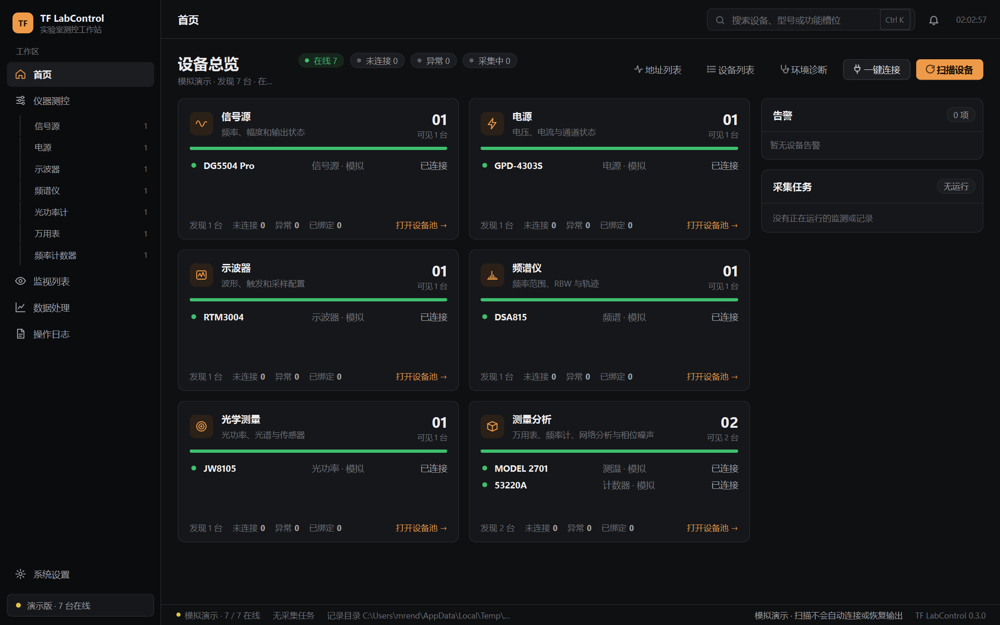
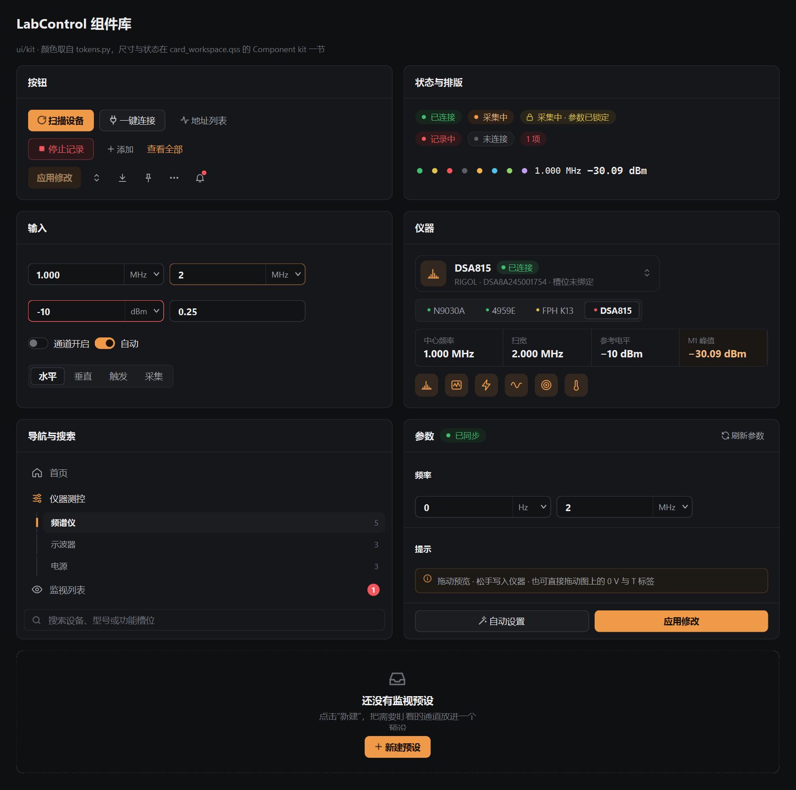

# 当前前端基线：石墨分类工作区

2026-11-17，用户认为历史深色琥珀卡片版“太丑”，要求重做前端。在 A 石墨、B 仪表、C Fluent 三个方向中，用户选定 **A · 石墨**，并要求“直接改项目，所有仪器都改进来”。2026-11-18 用户指出首轮只换了配色、布局和组件仍是旧样子，要求按 demo 的标准重做布局并建立常用组件库，前提是不破坏后端和设备操作。本页取代 2026-09-23 确认的历史卡片版（见文末历史记录）。

## 固定外观

- 中性石墨深色：背景、卡片、输入框和弹窗按层级逐级提亮，边框低对比；不使用渐变、霓虹或玻璃效果。
- 琥珀色只用于主操作、选中状态、主曲线和软件标记。标题、读数、普通数字使用中性白；状态使用独立语义色：绿色正常、黄色警告、红色异常、灰色未连接。
- 通道颜色全局唯一：CH1 琥珀黄、CH2 青、CH3 绿、CH4 紫，曲线、图例、通道标签、勾选框和控制面板一致。
- 左侧导航为图标加文字，“仪器测控”下以树形子项列出当前已连接的仪器类别（带台数，异常类别数字标红），取代原顶部分类标签；“系统设置”固定在底部，可收起为图标栏。顶栏一行显示“模块 / 子项”面包屑、设备搜索（Ctrl K，选中后进入对应页面）、告警铃（有异常设备时带红点）和时间。底部状态栏显示在线台数、采集与记录任务数、记录目录与剩余空间、最近一条消息和版本。设备池沿用原有逻辑。
- 首页仍是分类卡片：标题旁有在线、未连接、异常、采集中状态标签，右上只有“扫描设备”一个主按钮；每张卡片显示类别图标、在线数、状态比例条、前三台设备（型号、槽位或名称、连接状态）以及未连接、异常、已绑定数量，点击打开设备池；右侧一列显示设备告警和正在运行的采集任务，点击进入对应设备。首页不放整页设备表。
- 每台设备只有一个测控工作页。信号源保留逐通道设定、回读、输出和高级设置，桌面批量记录排除信号源。旧入口按稳定设备 ID 定位到对应工作页。支持采集的仪器页采用以下结构：页头左侧是设备卡（类别图标、型号、连接状态标签、厂家 · 名称 · 序列号 · 槽位，点击切换），同类有 2–6 台且宽度充足时旁边显示快切标签，右侧是采集间隔、开始/暂停监测、单次采集（示波器）、开始/停止记录；左侧图表卡（顶部读数条或标题与工具按钮，底部状态点、状态文字和实际帧间隔），右侧参数卡（“参数”与同步状态、刷新参数，分组字段，底部自动设置 / 应用修改）。参数字段的数值和单位在同一个输入框内，范围写在标签右侧（详情在悬停提示），自动开关用开关样式，已修改未应用的字段描琥珀边。示波器参数分为水平 / 垂直 / 触发 / 采集页，垂直页用通道标签切换。频谱页顶部读数条显示中心频率、扫宽、RBW/VBW、参考电平和第一个标记；示波器页显示通道零电平标签和触发电平标签（可上下拖动，拖动时预览，松手经原偏移/电平控件写入仪器）、软件测量（Vpp、RMS、频率）和独立的“单次采集”按钮。
- 监视列表为预设卡片加读数表，表头显示总数和超限数，状态列带颜色圆点，空预设和空列表给出操作提示；操作日志按日期、类别和关键词筛选审计记录；系统设置按分区卡片排列。

## 代码与入口

- 设计令牌：`src/lab_control/ui/styles/tokens.py`。运行时仍只加载 `ui/styles/card_workspace.qss`，其中颜色与令牌一致；绘制控件和 pyqtgraph 从令牌取色，新页面不硬编码颜色。
- 组件库：`ui/kit/`（`base` 状态点与标签、图标按钮、导航项；`controls` 按钮变体、开关、分段、字段框、搜索框；`layout` 卡片、分组、空状态、提示；`readouts` 读数条；`instrument` 设备卡与同类快切；`icons` 内联 SVG 线条图标），`python -m lab_control.ui.kit.gallery` 预览全部组件。分类卡片在 `ui/widgets/category_cards.py`，窗口外框（侧栏类别、搜索、告警、状态栏）在 `ui/workspace/chrome.py`，首页右侧列在 `ui/workspace/overview_side.py`，监测页排布在 `ui/pages/monitoring/frame.py`。
- 共用运行窗口仍为 `ui/real_window.py`；唯一开发启动脚本为 `run.bat`，`lab-control`、`python -m lab_control` 和安装版 EXE 共用 `launcher.main` 分发。Mock 仅用于内部测试和开发预览。
- 没有新增第三方依赖；图标使用 PySide6 自带的 QtSvg。正式入口的界面字体为 Windows 自带 Segoe UI Variable（Windows 10 回退 Segoe UI），中文由微软雅黑显示；测试与评审脚本仍固定使用微软雅黑以保持度量。

后续新增设备和功能沿用这套令牌、组件和分类卡片布局。未经用户明确调整方向，不把首页改为整页设备表，也不另选视觉方案。

## 历史记录

2026-09-23，用户在历史提交 `0ae6721` 的 `MainWindow + OverviewPage + DeviceCard + dark.qss` 渲染图上确认“是图上这个”，作为深色琥珀分类卡片版基线（截图保留在 `design/approved/card-overview.png`）。该版本的分类卡片结构、设备池和导航逻辑保留至今，配色与组件已由本页替代。历史 `ui/main_window.py`、`overview_page.py`、`device_card.py` 与 `dark.qss` 仅供比对，不重新启用。
