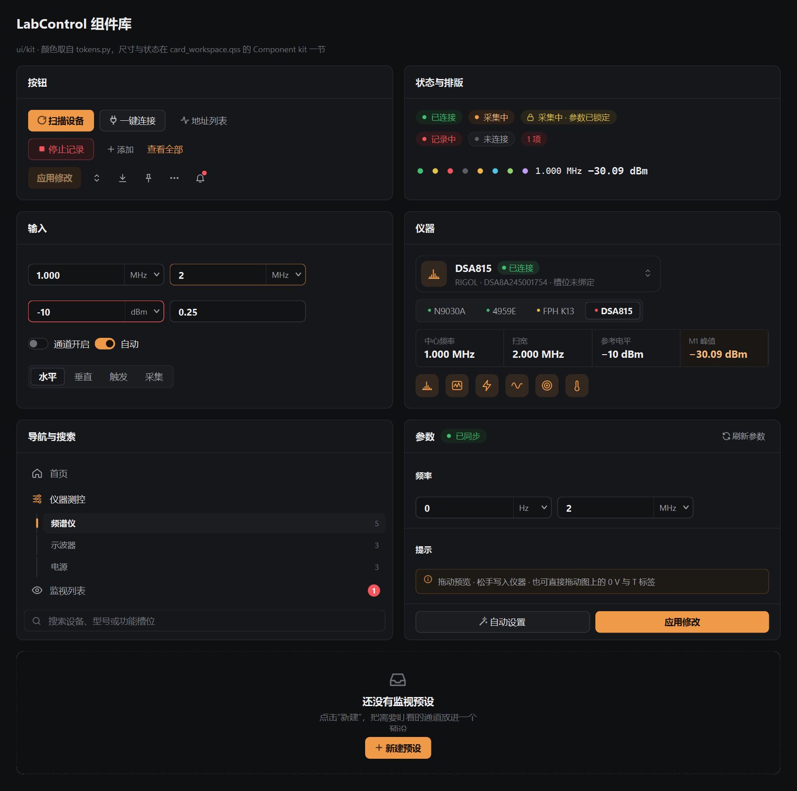

# 前端设计规范与组件库

修订日期：2026-11-25。

本页是新增页面、新型号界面和界面改版的操作规范，设备接入时与[接入流程](../testing/onboarding.md)一起执行。视觉方向以[确认的设计基线](../../direction-approved.md)为准；窗口结构、导航和服务边界见[前端架构](frontend-framework.md)。数值以代码为唯一来源：颜色在 `ui/styles/tokens.py`，组件在 `ui/kit/`，尺寸与状态样式在 `ui/styles/card_workspace.qss`。本页与代码不一致时以代码为准，并在同一变更中修正本页。

下文路径均相对 `src/lab_control/`。



## 1. 先选界面路线

新型号默认**不写界面代码**。按顺序判断，满足哪一条就停在哪一条：

| 路线 | 何时使用 | 做法 | 型号包内允许的界面代码 |
| --- | --- | --- | --- |
| A 公共类别页 | 型号属于已有类别，参数和采集能用能力、数据源和通道声明表达 | 只填注册元数据：类别、`capability_schema`/Profile、`acquisition_kinds`、`acquisition_channel_selection`、`monitoring_only`、`management_surface` 等；新操作的中文显示名补到 `application/controls.py` 的展示表 | 无 |
| B 扩展公共页 | 公共类别页缺少某个控件或状态，且同类其他型号也会用到 | 按能力声明在 `ui/pages/` 或 `ui/kit/` 中通用实现，所有同类型号一起受益；不按型号名或适配标识分支 | 无 |
| C 型号专属页 | 工作流无法映射到类别页，例如 Moku:Pro 的四槽角色 | 在 `DEFINITION` 注册 `role_page_factory` 和 `role_categories`，工厂函数内延迟导入页面；页面完全由组件库和第 4 节的仪器页骨架拼装 | 只有布局、信号连接和数据格式化；不得有 QSS、颜色、字体或尺寸常量 |

- 选择 C 之前，先在型号 README 的“界面接入”一节写明 A、B 为什么不够。现有 C 路线参考 `instruments/devices/liquid_moku_pro/workspace.py`。
- 一台设备同时承担多个角色并可同时运行（如 Moku:Pro 的信号源、示波器、频谱仪），每个角色页的页头下方都要有**角色条**：用 `DeviceChips` 列出全部角色及其状态（输出、采集中、记录中、空闲），点击即切换；多个角色共用的物理资源（同一输入前端、路由、参数锁）在角色条右侧写明。状态只取已有的监测快照和命令回执，不为显示而查询仪器；回执不是实时读回时要在提示中说明。参考 `instruments/devices/liquid_moku_pro/role_bar.py`。
- 无论哪条路线，页面都只调用应用服务和 `ui/controller.py`，不直接访问 PyVISA、串口或 SDK，不在界面里写厂家命令。
- 类别到页面的映射在 `ui/workspace/navigation.py` 的 `show_page`。监测侧：频谱仪 `SpectrumMonitoringPage`、示波器 `OscilloscopeMonitoringPage`、电源 `PowerMonitoringPage`、光功率计 `OpticalPowerMonitoringPage`、光谱仪 `OpticalSpectrumMonitoringPage`、频率计 `FrequencyCounterMonitoringPage`，其余类别使用通用 `MonitoringPage`（万用表扫描卡自动切换到 `ScanMonitoringPage`）。控制侧：信号源、相噪仪、电子负载和电源有专用页，其余类别使用 `DeviceControlPage` 加 `ControlForm`。
- 新增类别时先在 `domain/workspace.py` 登记类别标签，在 `ui/kit/icons.py` 的 `CATEGORY_ICONS` 选择或新增图标，再按路线 A 或 B 接页面。

## 2. 设计令牌

所有颜色、圆角和字体都从 `ui/styles/tokens.py` 取，`import lab_control.ui.styles.tokens as tk`。QSS 中写的是令牌的字面值；修改令牌时同步修改 QSS 中的对应值。

| 用途 | 令牌 | 规则 |
| --- | --- | --- |
| 页面、侧栏、卡片、卡片悬停、次级表面、悬停、按下、输入框、图表、弹窗 | `BG`、`SIDE`、`SURFACE`、`SURFACE_HOVER`、`SURFACE_2`、`HOVER`、`PRESSED`、`INPUT`、`CHART_BG`、`POPUP` | 由暗到亮逐级提亮表示层级，不用渐变、阴影、霓虹或玻璃效果 |
| 描边、强描边、悬停描边、网格 | `BORDER`、`BORDER_STRONG`、`BORDER_HOVER`、`GRID` | 卡片和分组只用 1 px 低对比描边 |
| 主文字、次文字、弱文字、禁用 | `TEXT`、`TEXT_2`、`TEXT_3`、`TEXT_DISABLED` | 标题、读数、普通数字一律用 `TEXT`，不用琥珀 |
| 品牌琥珀 | `ACCENT`、`ACCENT_HOVER`、`ACCENT_INK`、`ACCENT_SOFT`、`ACCENT_TEXT` | 只用于主操作、选中、主曲线和软件标记；一个区域只保留一个主按钮 |
| 状态 | `OK`、`WARN`、`ERR`、`INFO`、`IDLE`，或 `tk.STATUS[kind]` | 绿色正常、黄色警告、红色异常、灰色未连接或空闲；状态不用琥珀表示 |
| 通道与曲线 | `tk.channel_color(n)`、`CHANNEL_COLORS` | CH1 琥珀黄、CH2 青、CH3 绿、CH4 紫……曲线、图例、通道标签、勾选框和参数面板必须一致 |
| 圆角 | `RADIUS`（10，卡片）、`RADIUS_SM`（7，控件） | 弹窗由 QSS 统一处理 |
| 字体 | `FONT_UI`、`FONT_MONO` | 正文 13 px；字号和字重由 QSS 角色决定，页面不设置字体 |

需要半透明色时用 `tk.rgba(color, alpha)` 或 `QColor(...).setAlphaF(...)`，在令牌色上派生，不另写十六进制。

## 3. 组件目录

统一从 `lab_control.ui.kit` 导入。改动组件后运行 `python -m lab_control.ui.kit.gallery` 查看全部组件及状态，加上输出路径可直接渲染成截图。

| 模块 | 组件 | 用途与要点 |
| --- | --- | --- |
| `base` | `label(text, role)` | 文字角色：`title`（20 px 页标题）、`heading`（14 px 卡片标题）、`caption`（12 px 弱说明）、`muted`（12 px 次要）、`value`（15 px 等宽加粗数值）、`mono`（13 px 等宽数字） |
| | `Dot`、`Pill` | 状态点与状态标签；`Dot` 支持语义状态及通道色（`tk.channel_color(n)`）；`Pill` 支持 `kind`（`neutral`/`ok`/`warn`/`err`/`accent`/`info`）、`live=True` 采集脉冲及前置 `icon`（如 `icon="lock"` 表示采集中参数锁定），高 22 px |
| | `IconButton`、`IconTile` | 30 px 无边框图标按钮（图表工具栏统一用 `updown`、`download`、`more`、`eye`/`eyeoff`，告警铃可带红点角标）；类别图标方块 |
| | `ElideLabel`、`Separator` | 单行省略并自动给出完整提示；1 px 分隔线 |
| | `NavButton`、`SubNavButton` | 侧栏条目，仅外框 `ui/workspace/chrome.py` 使用 |
| | `set_property`、`repolish` | 动态属性改变后重新套用样式；值不变时不刷新 |
| `controls` | `button(text, variant, icon, size)`、`style_button(...)` | `variant`：空（次要）、`primary`、`danger`、`ghost`、`link`；`size`：空（32 px）、`sm`（26 px）、`lg`（36 px）。`style_button` 只改外观，不碰已有信号 |
| | `Switch` | 开关，继承 `QCheckBox`，`isChecked`/`toggled` 照常使用；所有“自动/开启”类布尔参数及通道开关用它 |
| | `Segmented` | 互斥分段，`changed` 发出条目数据；用于示波器水平/垂直/触发/采集分页及同级切换 |
| | `FieldBox` | 数值和单位在同一个 32 px 固定高度边框内；状态 `focus`、`dirty`（已修改未应用，琥珀描边）、`error`（红色，校验或范围异常） |
| | `SearchBox` | 顶栏搜索，Ctrl K 聚焦；`shortcut=""` 时自动隐藏快捷键角标 |
| `layout` | `Card(title, padding=…)` | 卡片：`header()` 标题行、`body` 内容、`footer()` 底部操作行，之间是 1 px 分隔；图表或读数条贴边时 `padding=0`；`add_status()` 在标题旁加状态标签 |
| | `Section(title, last=…)` | 参数卡内分组（频率、幅度、带宽……），最后一组设 `last=True` 去掉底线 |
| | `EmptyState`、`Hint` | 虚线空状态（图标、标题、说明和操作按钮）；琥珀或语义色的操作提示（不用于报错） |
| `readouts` | `ReadoutStrip(cells, highlight)` | 图表卡顶部读数条，按宽度自动换行；`embedded=True` 嵌入卡片头；高亮格用琥珀数值显示标记读数或触发摘要 |
| `instrument` | `PageHeader`、`DeviceChips`、`paint_device_card` | 仪器页页头、设备卡绘制，以及多功能设备的角色切换条。角色条使用 `DeviceChips`。条目不变只是状态变化时原位更新，不重建按钮 |
| `icons` | `icon(name, color)`、`paint(...)`、`CATEGORY_ICONS` | 24 格 1.8 线宽内联 SVG，按多种尺寸栅格化；新图标加入 `STROKE`，不放图片文件 |

组件库之外还有以下共享控件，接入时直接复用：

| 位置 | 控件 | 用途 |
| --- | --- | --- |
| `ui/widgets/device_selector.py` | `DeviceSelector` | 设备下拉卡片与可选的通道下拉；`selected`/`channel_changed` 信号；模拟型号规范化为中文类别名 |
| `ui/widgets/workspace_combo.py` | `WorkspaceComboBox` | 所有下拉框；弹出层与主题一致 |
| `ui/pages/device_control/editors.py` | `ParameterEditor`、`ArrayEditor` | 由参数定义生成输入框、单位、范围标签和回读反馈；自动套用 `FieldBox`（含 `dirty`/`error` 状态）与 `Switch`，并规范化频率 SI 前缀与 `degC` → `°C` |
| `ui/pages/monitoring/frame.py` | `page_layout`、`header_row`、`run_button`、`chart_card`、`show_state`、`empty_label` | 把已有页面的布局整理成第 4 节的骨架 |
| `ui/pages/monitoring/recording_state.py` | `RecordingButton`、记录状态 | 顶栏记录按钮在记录态显示红色 `停止记录 HH:MM:SS`（实时计时）；图表卡保持中性 1 px 描边，`recordingPhase` 驱动提示文案与状态 |
| `ui/widgets/input_wheel_guard.py` | 滚轮过滤器 | 全局安装，新字段无需再装；滚轮不改数值 |

## 4. 仪器页骨架

支持采集的仪器页统一为三块，不另起布局：

```text
┌─ 页头 ──────────────────────────────────────────────────────────────────┐
│ [设备卡：图标 型号 ●状态  厂家·名称·序列号·槽位 ⇅]   采集间隔 ▶监测 ⏺记录 │
└─────────────────────────────────────────────────────────────────────────┘
┌─ 图表卡 ────────────────────────────────┐ ┌─ 参数卡 ────────────────────┐
│ 读数条 或 标题 + 工具按钮                 │ │ 参数  ●已同步         ↻刷新 │
├─────────────────────────────────────────┤ ├────────────────────────────┤
│                                         │ │ 分组标题                    │
│ 图（pyqtgraph，CHART_BG）                │ │ 字段名        范围 低～高 单位 │
│                                         │ │ [ 数值        | 单位 ▾ ]    │
├─────────────────────────────────────────┤ ├────────────────────────────┤
│ ● 状态文字                     实际帧间隔 │ │ [自动设置]      [应用修改]  │
└─────────────────────────────────────────┘ └────────────────────────────┘
```

- **页面边距** 20/16/20/16，块间距 14（`frame.page_layout`）。右侧参数卡基准宽度固定在 `352 px`（范围 `340–380 px`），窄窗口时图表卡与参数卡改为上下排列（通用监测页的阈值为 680 px）。
- **页头**：左侧是 `DeviceSelector` 设备卡。点击设备卡下拉选择同类设备。右侧依次是采集间隔（0～60 秒）、开始/暂停监测（`frame.run_button`）（示波器使用分体按钮，箭头菜单包含单次采集、任务进行时的取消以及型号支持的完整存储读取）、开始/停止记录（`RecordingButton`）。窗口变窄时，间隔输入框和开始监测按钮一起换行。页头按钮总高 30 px（`buttonSize="compact"`）。连接状态已经显示在设备卡上，不再另放文字；卡片标题与列表不暴露裸 `mock://...` 地址串。
- 仪器图表在曲线、坐标轴和空白处共用单层石墨风格右键菜单。常规操作依次为「恢复视图」「保存当前帧数据」「导出 PNG」。仅支持单帧保存的页面显示保存项，空图时需要数据的操作置灰。保存使用打开菜单时的设备和显示帧，PNG 使用右键所在图的可见曲线。支持横向平移或缩放的图表同时恢复 X、Y 轴。趋势图回到最新跟随时间窗，电源两图联动。锁定扫频范围的频谱仪只恢复 Y 轴。频谱仪另提供「适应 Y 轴」和「在此频率添加标记」。
- 示波器图表右上角依次为恢复视图、保存当前帧。图底显示等待触发、单次采集、记录及错误状态。图内右键提供恢复视图、保存当前帧数据、导出 PNG。仪器操作菜单采用 `WorkspaceMenu` 的石墨色面板、悬停与键盘行为。Moku:Pro 示波器角色沿用相同图表操作。
- **批量记录**可在仪器测控总览直接勾选已连接且支持记录的设备。设备页与总览共用每台仪器的采集间隔。
- **图表卡**：头部放嵌入式 `ReadoutStrip`（频谱仪显示中心频率/扫宽/RBW/M1 峰值；示波器显示时基/采样率/记录深度/实际点数/触发与触发状态胶囊），没有读数时放标题，右侧统一放 `30×30` 图标工具按钮（`updown`、`download`、`more`）；中部是深色画布图（`CHART_BG`）；脚注左为状态点与状态文字，右为 `最新帧 HH:MM:SS · 实际 — s/帧`（顶栏不再重复显示实际帧间隔）。
- **参数卡**：头部统一 `52 px`（`cardHead`），放“参数”、`Pill` 同步/锁定状态胶囊和 ghost “刷新参数”；中部用 `Section` 分组的 `ParameterEditor`（读回时间显示本地 `HH:MM:SS`，完整时间放悬停提示），内容超出时整卡滚动；底部是“自动设置”（如支持）和主按钮“应用修改”。示波器参数分为水平、垂直、触发、采集四页，用 `Segmented` 切换；**垂直页不拆分通道子页签，而是将 CH1–CH4 纵向平铺在同一滚动页内**（每通道以彩色 `Dot`、通道名、右上角 `Switch` 和两行式档位/偏移滑块呈现），图下方提供 2×2 通道读数卡片，可一键显隐并点击定位高亮对应通道。
- **只有控制没有采集的设备**（信号源、电源、开关、负载……）按通道排卡片或紧凑操作卡：卡片头是彩色 `Dot` + 通道名和输出状态，中部是参数字段，底部按钮右对齐紧凑排布，不整行拉满。
- **首页设备总览**：顶栏为标题、状态计数胶囊（在线 / 未连接 / 告警 / 采集中）、折叠次级菜单 `⋯`、`一键连接` 与主按钮 `扫描设备`；主区域为双列分类卡片（显示在线数、前三台设备实时读数摘要与“打开设备池”入口），右侧 360 px 栏依次显示“状态监视”和“采集任务”。两张卡片等分右栏可用高度，随窗口一起伸缩。列表条数只影响各自的滚动范围。标题固定，读数和全部运行任务各自在卡片内滚动。“状态监视”标题下显示置顶预设名称，每行显示测点、监视量、设备或槽位、读数、单位和状态。越界读数与方向标红，顶部计数和铃铛汇总当前告警。
- **MCP 接入**使用两行设置。第一行显示服务状态、自动授权设备数和启停开关，第二行显示本机端口、连接地址及复制和导出操作。有任务运行时在下方逐行显示设备、操作、进度和“停止并保存”。
- **监视预设置顶**：预设栏提供“置顶到首页”和“取消置顶”。全工作区共用一个置顶选择，图钉标识的预设排在首位，其余预设按手动顺序排列。首页、编辑页和独立窗口共用可见视图的采集订阅。

### 状态必须完整

每个页面都要处理下表中的状态，并在评审截图中逐一出现：

| 状态 | 表现 |
| --- | --- |
| 未选择设备 / 无设备 | `EmptyState`（优先）或 `frame.empty_label`，写明下一步（扫描、在设备池选择） |
| 未连接 | 设备卡状态标签为灰色；需要通信的按钮和字段禁用 |
| 已连接、空闲 | 绿色状态；参数可编辑；监测按钮可用 |
| 等待同步 / 参数回读中 | 参数卡头部为黄色“等待同步”标签，回读完成后变为绿色“已同步” |
| 采集中 | 状态点慢速脉冲（`live=True`），开始按钮变为暂停；锁定参数的仪器在参数卡头显示黄色带锁胶囊 `Pill("采集中 · 参数已锁定", "warn", icon="lock")` |
| 记录中 / 收尾中 | 记录按钮变为红色 `停止记录 HH:MM:SS`（实时计时）或 `收尾中…`，图表卡保持中性 1 px 描边（`recordingPhase` 驱动提示与状态）；参数锁定到二进制收尾完成 |
| 已修改未应用 | 草稿与回读不一致的字段设置 `FieldBox` 的 `dirty`（琥珀描边），“应用修改”可用 |
| 越界或写入失败 | `FieldBox` 设置 `error`（红色描边），字段下方的反馈标签写明原因；不默默钳位，不自动重试写入 |
| 设备异常 | 红色状态标签，侧栏类别计数标红，脚注写明原因 |

## 5. 参数字段与文案

- **字段**：一律通过 `ParameterEditor` 由参数定义生成，不手搓 `QLineEdit` 加 `QComboBox`。数值和单位在同一个 `FieldBox` 内；范围以“低～高 单位”写在标签右侧（`rangeHint`），详情放悬停提示。布尔量用 `Switch`，枚举用 `WorkspaceComboBox`。
- **写入流程**：修改只改草稿并显示 `dirty`；点“应用修改”才写仪器，写完以回读值刷新字段。拖动预览（如示波器零电平和触发电平标签）在松手后才经原控件写入。前端限幅只是提示，后端仍需严格校验；不得默默钳位，不得重发命令。
- **单位与时间**：使用国际单位和常用前缀（Hz/kHz/MHz/GHz、V/mV、dBm、s/ms/µs、°C），数值与单位之间不留歧义；范围标签中频率自动换算为可读 SI 前缀（如 `1 µHz ～ 500 MHz`），`degC` 规范显示为 `°C`；读数条显示到有意义的有效位，不显示原始科学计数字符串；回读与最新帧时间戳简写为本地 `HH:MM:SS`（完整 ISO 时间放入 tooltip）。
- **文案**：界面全部中文，型号、单位和通道名（CH1）保留原文。常用词保持一致：

| 场景 | 统一用词 |
| --- | --- |
| 连接状态 | 已连接、未连接、连接中、异常 |
| 采集 | 开始监测、暂停、单次采集、采集中 |
| 记录 | 开始记录、停止记录、记录中、收尾中 |
| 参数 | 刷新参数、应用修改、自动设置、已同步、等待同步 |
| 输出 | 输出开启、输出关闭 |

- 按钮用动词开头的短语。会中断当前任务的操作（如停止记录）用 `danger` 变体。每个区域只有一个主按钮。

## 6. 图表

- 波形、频谱和趋势图只用 pyqtgraph，不引入其他图表库。背景 `CHART_BG`，网格 `GRID`，坐标轴文字 `TEXT_3`，曲线颜色按第 2 节的通道色，单曲线时主曲线用 `ACCENT`。
- 频谱和示波器的绘图逻辑由用户调优过，改版只改外观（颜色、边距、标签），不改数据处理、刷新节奏和标记算法。
- 标记、零电平和触发标签用通道色或琥珀；坐标单位跟随参数单位。带符号的曲线和散点标记设置 `useCache=False`，避免缩放后出现像素碎片，写法参照 `ui/pages/monitoring/plot.py` 和 `oscilloscope_plot.py`。

## 7. 禁止事项

以下写法在评审时一律退回：

1. 在页面、对话框或型号包里调用 `setStyleSheet`，或写十六进制颜色、`QColor("#…")`、字号、字体名。需要新外观时在 QSS 中加选择器，颜色取令牌值。
2. 为单个型号新建 QSS 段落或 objectName。确有通用需要时，把选择器加到 QSS 的“component kit”或对应页面段落，并在组件库预览里加示例。
3. 不经组件库直接 `QPushButton()` 后自行定尺寸或配色。用 `button`/`style_button`，尺寸用 `kitSize` 或 `buttonSize`（compact 30、panel 36、dialog 38）。
4. 在 QSS 中写 `X QWidget { background: transparent; }`。它会把卡片内按钮背景一起清掉，只能写 `.QWidget`（只匹配纯 QWidget）。
5. 在 QWidget 子类里赋值 `self.window = …`。它会遮蔽 `QWidget.window()`，导致事件过滤器连锁报错。
6. 在同一布局里对同一个按钮先 `removeWidget` 再 `addWidget`，PySide 会崩溃；应按最终顺序构建。
7. 构造时不指定父控件、还没放进布局就调用 `show()`、`setVisible(True)` 或刷新显示状态。这会闪出独立顶层窗口并抢走主窗口焦点；内嵌卡片和组件内部子控件构造时就要绑定父控件并在 `addWidget(...)` 之后再切换显隐。
8. 隐藏 `DeviceCombo`。焦点转移依赖它，只能改绘制，不能隐藏。
9. 引入新的第三方界面库、图标字体、图片主题或 GPL 主题组件，或另起视觉方向。
10. 在型号包的 `__init__.py` 顶层导入 Qt 页面。注册表加载不得创建界面，`role_page_factory` 内延迟导入。

## 8. 扩展组件库

组件库缺东西时，先扩展组件库，再在页面里使用：

1. 在 `ui/kit/` 对应模块中实现：只用令牌色，状态通过动态属性加 `set_property` 切换，不在组件内写样式表。
2. 在 `card_workspace.qss` 的“component kit”段落添加选择器，数值使用令牌字面值。
3. 在 `ui/kit/__init__.py` 导出，在 `ui/kit/gallery.py` 加上各状态的示例。
4. 更新本页第 3 节的组件目录，以及受影响的布局测试。只改布局断言，不放松功能断言。
5. 重新渲染组件库截图；外观变化经用户确认后，再更新 `design/approved/graphite-components.png`。

## 9. 界面验收

接入设备或修改界面时，以下各项与功能测试一起完成，缺一项不算完成：

- [ ] 已在型号 README“界面接入”写明路线（A/B/C）、使用的页面和新增的公共控件
- [ ] 新代码没有 `setStyleSheet`、十六进制颜色和字体常量（见下方自查命令）
- [ ] 第 4 节状态表中的状态都能在 Mock 中复现并截图
- [ ] 1280×760 与 1440×900，100%、125%、150% 缩放下没有截断、重叠或横向滚动；窄窗口下改为上下排列
- [ ] 截图保存到 `design/reviews/<型号或主题>/`，同目录写 `render.json` 或 `metrics.json` 记录分辨率和缩放；验收记录按[验收记录](../reviews/README.md)的格式登记
- [ ] 改动组件库时，组件库预览（`python -m lab_control.ui.kit.gallery`）的截图已更新
- [ ] 布局和交互测试已覆盖新页面：型号专属界面测试放在型号包 `tests/`，公共页面测试放在顶层 `tests/integration/`
- [ ] 通过 pytest、Ruff、Mypy 和文档检查（命令见[模块规范](device-modules.md#验证命令)）

自查命令（在项目根目录用 PowerShell 运行）。结果中只能出现第 10 节已登记的存量位置；加载主题的 `setStyleSheet(load_stylesheet())` 已被排除：

```powershell
Get-ChildItem src/lab_control -Recurse -Filter *.py | Where-Object { $_.FullName -notmatch '\\(styles|kit|tests)\\' } | Select-String -Pattern 'setStyleSheet\((?!load_stylesheet)|[''"]#[0-9a-fA-F]{6}[''"]'
```

渲染截图时，测试和评审脚本固定使用微软雅黑以保持度量；正式入口字体见[前端架构](frontend-framework.md#5-视觉规范)。

## 10. 存量偏差

以下为合理例外或历史兼容位置；新代码不得模仿历史页面专用选择器与旧主题：

| 位置 | 说明 | 迁移方向 |
| --- | --- | --- |
| `ui/widgets/publication_figure.py`、`publication_table.py` | 论文导出插图/表格使用白底打印配色 | 属印刷出版专用配色，保留并在源码内独立维护 |
| `domain/oscilloscope.py` | 复制了前四个通道色 | domain 层不能依赖 ui，保留副本；修改 `CHANNEL_COLORS` 时同步修改 |
| QSS 中的 `spectrumChart`、`powerMeterWorkspace`、`scopeControls`、`spectrumControls` 等页面专用选择器 | 外观已对齐 `chartCard`/`paramCard` | 新页面使用 `Card`、`chart_card` 和 `paramCard`，不再新增页面专用卡片选择器 |
| `ui/styles/dark.qss`、`ui/main_window.py` | 历史琥珀版，仅供比对 | 不加载、不修改、不参考 |
